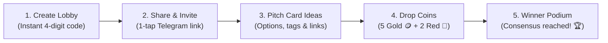

# 🪙 CoinDrop

<p align="center">
  <strong>Cozy Multiplayer Decision Lobby</strong><br>
  <em>Group decisions made fun. Propose ideas, share with friends, and drop your coins to decide live.</em>
</p>

<p align="center">
  <a href="https://coindrop-nuxt.sanghakh122333.workers.dev/"><strong>🌐 Live Demo</strong></a> •
  <a href="https://github.com/srossongha/coindrop-nuxt"><strong>📦 GitHub Repository</strong></a> •
  <a href="#-quick-start"><strong>⚡ Quick Start</strong></a> •
  <a href="#-architecture"><strong>🏗️ Architecture</strong></a>
</p>

<p align="center">
  
  
  
  
  
  
  
</p>

---

## 💡 The Problem

> _"Where should we eat tonight?"_  
> _"Which movie should we watch?"_  
> _"Where should we travel for the long weekend?"_

Group chats usually descend into endless debate loops, indecision, or one person reluctantly choosing for everyone. Traditional survey tools require signups, are overly formal, and lack excitement.

## ✨ The Solution: CoinDrop

**CoinDrop** turns decision-making into a cozy, frictionless multiplayer lounge:

- **Zero signups or accounts needed** — jump right into a room in seconds.
- **Pitch options collaboratively** — add food spots, movies, road trips, or activities with links and notes.
- **Vote with tactile physics coins** — drop gold coins (1pt) and super red coins (2pt) in real-time.
- **Winner emerges automatically** — real-time tallying crowns the group favorite on a celebratory podium.
- **Ephemeral & private** — when the host closes the room, all data is immediately cleared.

---

## 🎮 Game Loop



1. **Host Creates a Room**: Enter a topic (or tap a quick suggestion like `Friday Hotpot 🍲`) to spawn a lobby.
2. **Friends Join Instantly**: Share the 4-digit code (e.g. `#DROP-2062`) or send a 1-tap Telegram invite link.
3. **Brainstorm Options**: Anyone in the room adds cards with categories, price notes, and web links.
4. **Live Coin Voting**: Everyone receives a personal pouch with **5 Gold Coins** (1 pt each) and **2 Super Red Coins** (2 pts each) to distribute across options.
5. **Winner Crowned**: Dynamic score updates reveal the leader in real-time, concluding with a celebratory winner podium.

---

## 🚀 Key Features

### 🍎 Apple-Grade Motion & Interactions

- **Sliding Pill Segmented Control**: Smooth indicator pill that glides seamlessly under the active tab with Apple's natural fluid easing (`cubic-bezier(0.16, 1, 0.3, 1)`).
- **Directional Slide Transitions**: Outgoing cards slide left/right according to navigation direction (`slide-left` / `slide-right`).
- **Dynamic Box Height Morphing**: Driven by `ResizeObserver` and transition hooks, card containers smoothly grow and shrink without layout jumping.
- **Teleported Fullscreen Modals**: All dialogs, share sheets, and rosters teleport to `document.body` for pristine, unclipped centering across all viewports.

### 🪙 Tactile Weighted Voting

- **Physics Coin Drops**: Dropped coins trigger bouncy impact recoil, audio feedback, and floating `+1 🪙` / `+2 🔴` particle reactions.
- **Interactive Coin Hopper**: Displays live coin counters and coin retrieval buttons so players can re-strategize their votes.
- **Sticky Coin Pouch**: Floating bottom pouch on mobile and desktop keeps remaining coin counts always accessible.

### 🦫 Cute Mascot Personas

- Automatic assignment of friendly animal mascots (`🦫 Capybara`, `🦊 Fox`, `🐼 Panda`, `🐸 Frog`, `🦁 Lion`, `🦉 Owl`, etc.).
- 1-tap randomizer button or custom nickname selector anytime.

### 📱 Full-Spectrum Responsiveness

- Engineered for seamless usability across screen widths from **320px ultra-compact phones** (iPhone SE) to **4K ultra-wide monitors**.
- Dynamic `100dvh` viewport handling, touch manipulation optimization, and iOS Safari input zoom suppression (`text-base sm:text-sm`).

### 🔒 Ephemeral by Design

- CoinDrop is an ephemeral decision room, not permanent storage.
- When the host clicks **"Close Lobby & Clear"**, all cards, votes, and participant sessions are permanently erased.

---

## 🛠️ Tech Stack

| Layer              | Technology                                            | Purpose                                                    |
| ------------------ | ----------------------------------------------------- | ---------------------------------------------------------- |
| **Framework**      | [Nuxt 4](https://nuxt.com/) (v4.6+)                   | Fullstack modern Vue 3 framework with SSR & Edge engine    |
| **Styling**        | [Tailwind CSS v4](https://tailwindcss.com/)           | Theme-driven design system with native `@theme` CSS tokens |
| **Runtime & Edge** | [Cloudflare Workers](https://workers.cloudflare.com/) | Serverless edge deployment with Nitro `cloudflare_module`  |
| **Realtime Sync**  | [Supabase Realtime](https://supabase.com/)            | Global WebSocket broadcast channels & Postgres sync        |
| **Icons**          | [Lucide Vue Next](https://lucide.dev/)                | Clean, lightweight icon suite                              |
| **Code Quality**   | ESLint + Prettier                                     | Automated formatting with `@nuxt/eslint` stylistic rules   |

---

## 📁 Project Structure

```text
coindrop/
├── app/
│   ├── assets/
│   │   └── css/
│   │       └── main.css           # Tailwind v4 @theme, custom easing & motion utilities
│   ├── components/
│   │   └── ui/
│   │       ├── CardCoinSlot.vue   # Coin hopper, physics drops, floating score particles
│   │       ├── CoinPouchBar.vue   # Floating bottom user coin pouch
│   │       ├── CreateIdeaModal.vue# Card proposal modal with categories & links
│   │       ├── IdentityModal.vue  # Mascot & nickname customizer
│   │       ├── LobbyCard.vue      # Idea card with live leader tags & winner styling
│   │       └── LobbyHeader.vue    # Top lobby bar, Telegram share, host controls
│   ├── composables/
│   │   ├── useIdentity.ts         # User persona state (localStorage + broadcast)
│   │   ├── useLobby.ts            # Central lobby game state, voting logic & actions
│   │   └── useSupabase.ts         # Supabase WebSocket broadcast & fallback sync
│   ├── pages/
│   │   └── index.vue              # Main app entry: landing view + active multiplayer lounge
│   └── types/
│       └── index.ts               # Core TypeScript definitions (Room, Card, Vote, Persona)
├── public/                        # Static public assets
├── nuxt.config.ts                 # Nuxt 4 configuration & Nitro Cloudflare presets
└── package.json                   # Scripts and project dependencies
```

---

## ⚡ Quick Start

### 1. Prerequisites

- **Node.js** `>= 20.x`
- **pnpm** `>= 9.x` (recommended)

### 2. Clone & Install

```bash
git clone https://github.com/srossongha/coindrop-nuxt.git
cd coindrop-nuxt
pnpm install
```

### 3. Environment Variables

Create a `.env` file in the root directory (refer to `.env.example`):

```bash
cp .env.example .env
```

Add your Supabase API credentials:

```env
SUPABASE_URL=https://your-project-id.supabase.co
SUPABASE_KEY=your-anon-public-key
```

> **Note:** CoinDrop also includes built-in offline/in-memory fallback mode for local testing without Supabase credentials.

### 4. Run Development Server

```bash
pnpm dev
```

Open [http://localhost:3000](http://localhost:3000) in your browser.

---

## 🧪 Available Scripts

| Script          | Command             | Description                                                      |
| --------------- | ------------------- | ---------------------------------------------------------------- |
| **Development** | `pnpm dev`          | Starts local Nuxt 4 development server with hot-reload           |
| **Build**       | `pnpm build`        | Compiles application for production with Nitro Cloudflare preset |
| **Preview**     | `pnpm preview`      | Locally previews the production build                            |
| **Lint**        | `pnpm run lint`     | Runs ESLint checks across the codebase                           |
| **Lint & Fix**  | `pnpm run lint:fix` | Automatically fixes code style and linting issues                |
| **Format**      | `pnpm run format`   | Runs Prettier code formatting                                    |

---

## 🚢 Deployment

### Deploying to Cloudflare Workers

CoinDrop is pre-configured for Cloudflare Workers via Nitro's `cloudflare_module` preset.

1. **Build the production bundle**:

   ```bash
   pnpm build
   ```

2. **Deploy via Wrangler**:

   ```bash
   npx wrangler --cwd .output deploy --name coindrop-nuxt
   ```

3. **Set Cloudflare Environment Variables**:
   In your Cloudflare dashboard (or via Wrangler CLI):
   ```bash
   npx wrangler secret put SUPABASE_URL
   npx wrangler secret put SUPABASE_KEY
   ```

---

## 🤝 Contributing

Contributions, issues, and feature requests are welcome!
Feel free to check the [issues page](https://github.com/srossongha/coindrop-nuxt/issues).

1. Fork the project
2. Create your feature branch (`git checkout -b feat/amazing-feature`)
3. Commit your changes (`git commit -m 'feat: add amazing feature'`)
4. Push to the branch (`git push origin feat/amazing-feature`)
5. Open a Pull Request

---

## 📄 License

Distributed under the **MIT License**. See `LICENSE` for more information.

<p align="center">
  Built with ❤️ for smooth, cozy group decisions.
</p>
